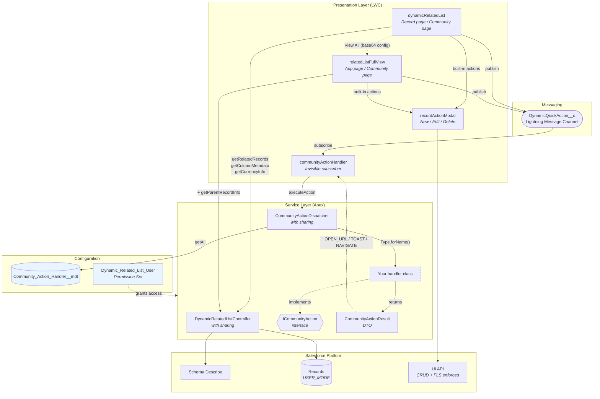
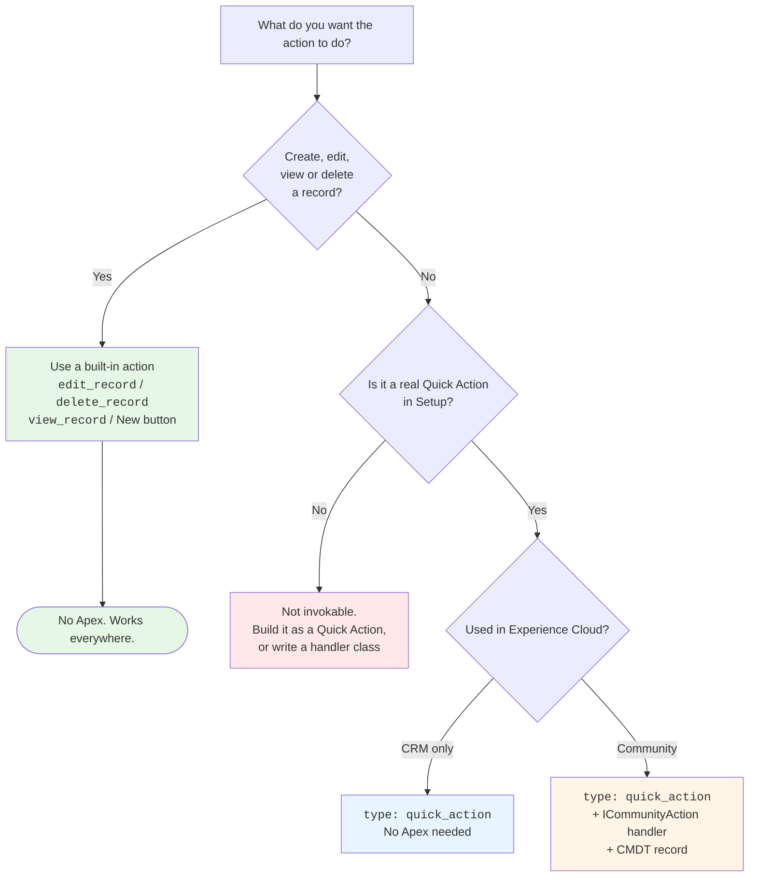
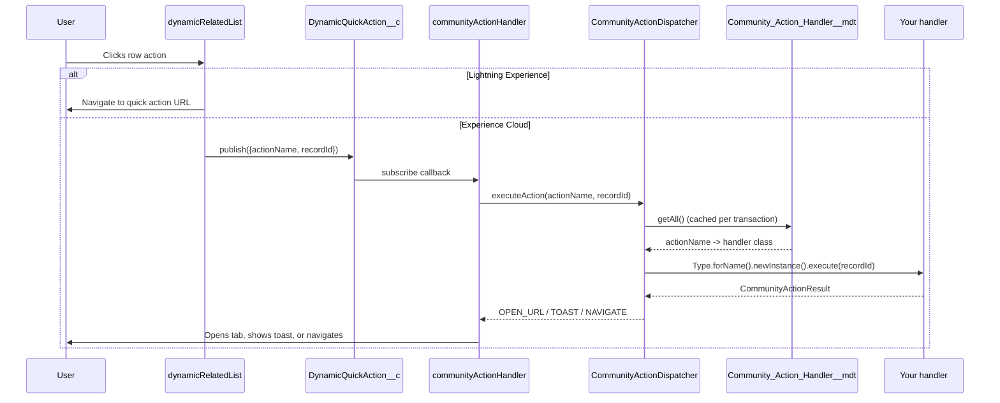

# Dynamic Related List

A configuration-driven related list for Lightning Experience and Experience Cloud. Drop the component on any record page, point it at a child object and a lookup field, and it renders a fully formatted, sortable related list — no Apex or LWC changes required per use case.

Part of the **SFDC DEV Essentials** collection.

---

## Why

Salesforce's standard related lists are tied to the page layout and can't be used in Experience Cloud with arbitrary field sets, relationship traversal, or custom row actions. This package replaces that with a single reusable component driven entirely by App Builder properties and Custom Metadata.

### Features

- **Any child object, any lookup** — configured via App Builder, not code
- **Relationship traversal** — display `Account.Owner.Name` style paths, arbitrarily deep
- **Automatic column metadata** — labels and data types (currency, date, phone, email, URL, percent, boolean, reference) resolved from the schema
- **Picklist labels** — `toLabel()` applied automatically so users see display values, not API values
- **Multi-currency aware** — renders each amount in the record's own currency with conversion to the running user's currency
- **Record links** — the first column links to the record; lookup columns resolve to the related record's `Name` instead of a raw ID
- **Built-in New / Edit / Delete** — no Apex, no Quick Actions, identical behaviour in CRM, Aura sites and LWR sites
- **"View All" full page** — pagination (25/50/100/200/1000), column sorting, breadcrumbs
- **Pluggable custom actions** — a quick-action framework for Experience Cloud, where standard quick action URLs don't render
- **Secure by default** — `with sharing`, `AccessLevel.USER_MODE`, and describe-based validation of every dynamic SOQL identifier

---

## Architecture



### Design principles

| Principle | How it's applied |
|---|---|
| **Zero code per use case** | All list behaviour comes from App Builder properties |
| **Zero code per action** | Built-in actions need nothing; custom handlers are registered in Custom Metadata and resolved via `Type.forName()` |
| **Platform-agnostic UI** | Built-in actions use the UI API and plain SLDS markup, so they work in CRM, Aura sites and LWR sites alike |
| **Open/closed** | `ICommunityAction` is the extension point; the dispatcher never changes |
| **Least privilege** | `USER_MODE` queries plus a single assignable permission set |
| **Fail closed** | Any field path that doesn't resolve against describe is rejected |

---

## Components

| Type | Name | Purpose |
|---|---|---|
| LWC | `dynamicRelatedList` | The related list card itself |
| LWC | `relatedListFullView` | Paginated full-page view behind "View All" |
| LWC | `recordActionModal` | Internal modal for built-in New / Edit / Delete (UI API based) |
| LWC | `communityActionHandler` | Invisible subscriber that executes custom quick actions in Experience Cloud |
| Apex | `DynamicRelatedListController` | Dynamic SOQL, schema describe, currency info |
| Apex | `CommunityActionDispatcher` | Routes action names to handler classes |
| Apex | `ICommunityAction` | Interface implemented by action handlers |
| Apex | `CommunityActionResult` | Result DTO (`OPEN_URL` / `TOAST` / `NAVIGATE`) |
| CMDT | `Community_Action_Handler__mdt` | Action → handler class registry |
| LMC | `DynamicQuickAction__c` | Carries `actionName` + `recordId` to the handler |
| FlexiPage | `Related_List_Full_View` | App page hosting the full view |
| CustomTab | `Related_List_Full_View` | Tab used for CRM navigation to the full view |
| PermissionSet | `Dynamic_Related_List_User` | Grants access to everything above |

---

## Prerequisites

- [Salesforce CLI](https://developer.salesforce.com/tools/salesforcecli) (`sf` v2+)
- VS Code with the [Salesforce Extension Pack](https://developer.salesforce.com/docs/platform/sfvscode-extensions/guide/install.html)
- An authorised org (Developer Edition, sandbox, or scratch org)

No managed packages or external dependencies.

---

## Setup

### 1. Authorise the org

```bash
sf org login web --alias MyOrg --set-default
```

### 2. Validate before deploying

```bash
sf project deploy start \
  --manifest manifest/package.xml \
  --target-org MyOrg \
  --dry-run \
  --test-level RunSpecifiedTests \
  --tests CommunityActionDispatcherTest \
  --tests DynamicRelatedListControllerTest
```

### 3. Deploy

```bash
sf project deploy start --manifest manifest/package.xml --target-org MyOrg
```

Or promote the validated run without re-running tests:

```bash
sf project deploy quick --job-id <validation-job-id> --target-org MyOrg
```

### 4. Assign the permission set

```bash
sf org assign permset --name Dynamic_Related_List_User --target-org MyOrg
```

> **Note:** The permission set grants Apex class access, Custom Metadata read, and tab visibility. It deliberately does **not** grant object or field permissions on your child object — users still need read access to those records through their profile or another permission set, because all queries run in `USER_MODE`.

### 5. Add the component to a page

Edit a record page in App Builder, drag **Dynamic Related List** onto the page, and configure the properties below.

For Experience Cloud, also drop **Community Action Handler** anywhere on the page if you use quick actions.

---

## Configuration

### Component properties

| Property | Required | Default | Description |
|---|:---:|---|---|
| `childObjectApiName` | Yes | — | API name of the child object, e.g. `Contact` |
| `relationshipFieldApiName` | Yes | — | Lookup/master-detail field on the child pointing to the parent, e.g. `AccountId` |
| `fieldApiNames` | Yes | — | Comma-separated columns. Supports traversal: `FirstName,LastName,Account.Owner.Name` |
| `cardTitle` | No | `Related Records` | Card heading; the record count is appended automatically |
| `iconName` | No | `standard:related_list` | Any SLDS icon name |
| `sortField` | No | — | Default sort column |
| `sortDirection` | No | `ASC` | `ASC` or `DESC` |
| `recordLimit` | No | `10` | Max records shown on the card |
| `rowActions` | No | — | JSON array of row actions (see below) |
| `showRowNumbers` | No | `false` | Show the row number column |
| `showNewButton` | No | `false` | Adds a **New** button to the header that creates a child record with the parent lookup pre-filled |
| `hideRecordLink` | No | `false` | Suppress the link on the first column |
| `recordId` | Community only | — | Set to `{!recordId}` on community pages |

---

## Actions

This is the part that trips people up most, so read this section before configuring `rowActions`.

There are **three different kinds of action**, and they behave very differently:

| Kind | Example | Apex handler needed? | Works in CRM | Works in Aura site | Works in LWR site |
|---|---|:---:|:---:|:---:|:---:|
| **Built-in** | `view_record`, `edit_record`, `delete_record`, New button | No | Yes | Yes | Yes |
| **Real Quick Action** | `Contact.Log_a_Call`, `Case.New_Task` | CRM: no<br>Community: **yes** | Yes | Only with handler | Only with handler |
| **Standard layout button** | `Edit`, `Delete`, `Clone`, `DataDotComGetContactsMultiAddAction` | n/a | **No** | **No** | **No** |

### 1. Built-in actions — recommended

These need no Apex, no Custom Metadata and no Quick Action in Setup. They are handled entirely client-side by `recordActionModal` using the UI API, so they behave identically everywhere.

```json
[
  { "label": "View",   "name": "view_record" },
  { "label": "Edit",   "name": "edit_record" },
  { "label": "Delete", "name": "delete_record" }
]
```

| Name | Behaviour |
|---|---|
| `view_record` | Navigates to the record |
| `edit_record` | Opens a modal with `lightning-record-edit-form` for the configured fields |
| `delete_record` | Opens a confirmation modal, then calls `deleteRecord()` |
| *New button* | Enable `showNewButton`; opens a create modal with the parent lookup injected on submit |

The create/edit form renders the **direct** fields from `fieldApiNames`. Traversal paths (`Account.Owner.Name`), `Id` and the relationship field are excluded automatically — the relationship field is force-set on submit so it can't be overridden from the form.

CRUD and FLS are enforced by the UI API, so a user without delete permission simply gets an error from the platform.

> **Deliberate design note:** these use the UI API rather than `NavigationMixin` record actions (`actionName: 'edit'`) or `platformShowToastEvent`, because those are not reliably supported in LWR sites. The modal is plain SLDS markup for the same reason.

#### Showing and hiding the buttons

New uses a different mechanism from Edit and Delete.

**New — a boolean property.** Tick or untick **Show New Button** (`showNewButton`) on the component in App Builder or Experience Builder. It defaults to `false`, so the button is hidden until you enable it. The full view inherits the setting automatically — `handleViewAll()` passes it through the base64 config as `n`, so you never configure it twice.

**Edit and Delete — presence in `rowActions`.** There is no separate toggle. The row-action menu is built from whatever is in the JSON, and the action column is only added when the array is non-empty:

```js
const actions = this.parsedRowActions;
if (actions.length > 0) {
    cols.push({ type: 'action', typeAttributes: { rowActions: actions } });
}
```

| Goal | `rowActions` value |
|---|---|
| View + Edit + Delete | `[{"label":"View","name":"view_record"},{"label":"Edit","name":"edit_record"},{"label":"Delete","name":"delete_record"}]` |
| Edit only | `[{"label":"Edit","name":"edit_record"}]` |
| Delete only | `[{"label":"Delete","name":"delete_record"}]` |
| No row menu at all | Leave `rowActions` blank |

Leaving it blank means the chevron column doesn't render at all, rather than rendering an empty menu.

**Two limitations to be aware of:**

1. **All-or-nothing per component, not per row.** Every row gets the same menu. If a user lacks delete permission, Delete still appears — they get an error from the UI API when they confirm. Per-row permission filtering would require reading `deletable`/`updateable` from `getObjectInfo` and filtering the action list.
2. **Config lives per component instance.** `rowActions` is set on each placement, so a record page and a community page showing the same list each need their own copy of the JSON. The full view inherits from whichever card the user clicked "View All" on.

### 2. Real Quick Actions

A Quick Action is something defined in **Setup → Object Manager → Buttons, Links and Actions** with an Action Type of *Create a Record*, *Update a Record*, *Log a Call*, *Send Email*, *Flow*, *Lightning Web Component*, *Aura Component* or *Visualforce*.

```json
[{ "label": "Log a Call", "name": "Case.Log_a_Call", "type": "quick_action" }]
```

- **In CRM** this works with no Apex. The component navigates to `/lightning/action/quick/<ActionApiName>` and the Lightning shell renders the modal.
- **In Experience Cloud** there is *no platform API to launch a quick action modal* — the Lightning shell that renders it doesn't exist. The component therefore publishes to the `DynamicQuickAction__c` message channel, and `communityActionHandler` asks `CommunityActionDispatcher` what to do.

So in a community, **every** `"type": "quick_action"` entry needs a registered handler. Without one the user sees *"No handler registered for action: X"*. See [Extending](#extending-custom-quick-actions) below.

If the Quick Action is just creating or editing a record, prefer a built-in action instead — you get community support for free.

### 3. Standard layout buttons — not supported

Entries like `Edit`, `Delete`, `Clone`, `PrintableView`, `ChangeOwnerOne` or `DataDotComGetContactsMultiAddAction` appear in the same Setup list but are **not** Quick Actions. They have no `/lightning/action/quick/` route, so they cannot be invoked from any custom component — in CRM or in a community.

Use the built-in `edit_record` / `delete_record` actions instead.

To check whether something is addressable, paste this against a real record Id:

```
https://<your-domain>.lightning.force.com/lightning/action/quick/Contact.My_Action?objectApiName&context=RECORD_DETAIL&recordId=003XXXXXXXXXXXX
```

If a modal opens, it's a real Quick Action.

### Decision guide



---

## Extending: custom quick actions

Use this **only** for behaviour the built-in actions can't express — callouts, document retrieval, PDF generation, bespoke logic. For plain create/edit/delete, use the built-in actions instead.

Standard quick action URLs don't render as modals in Experience Cloud. This package works around that with a message-channel plus dispatcher pattern.



### Add a new action — no code changes to this package

**Step 1.** Implement the interface:

```apex
public with sharing class ViewInvoiceCommunityAction implements ICommunityAction {
    public CommunityActionResult execute(Id recordId) {
        // ... your logic ...
        return CommunityActionResult.openUrl('/resource/InvoicePdfViewer#' + payload);
        // or CommunityActionResult.toast('Error', 'Not found', 'error');
        // or CommunityActionResult.navigate(someRecordId);
    }
}
```

**Step 2.** Register it under **Setup → Custom Metadata Types → Community Action Handler → Manage Records → New**:

| Field | Value |
|---|---|
| Label / Name | `View Invoice` |
| Action Name | `My_Object__c.View_Invoice` |
| Handler Class | `ViewInvoiceCommunityAction` |
| Active | checked |

The dispatcher prefers an exact `Action Name` match and falls back to a `contains` match, so you can register either a fully qualified action name or a shared fragment.

**Step 3.** Grant access to the new class on the permission set.

---

## Security model

| Concern | Implementation |
|---|---|
| Sharing | Both service classes are `with sharing` |
| CRUD / FLS | All queries use `Database.query(..., AccessLevel.USER_MODE)` |
| SOQL injection | Object, relationship field, every field path and the sort field are validated against `Schema` describe before concatenation. Unresolvable identifiers throw `AuraHandledException` |
| Bind variables | `parentRecordId` is bound (`:parentRecordId`), never concatenated |
| Untrusted input | The full view rebuilds its config from a base64 URL parameter — which is exactly why describe validation is mandatory, not optional |
| Describe limits | `Schema.getGlobalDescribe()` is cached in a static and resolved once per transaction |

> `USER_MODE` means a user lacking FLS on a configured field gets an error rather than silently missing data. That is intentional.

---

## Testing

```bash
sf apex run test \
  --target-org MyOrg \
  --tests CommunityActionDispatcherTest \
  --tests DynamicRelatedListControllerTest \
  --result-format human \
  --code-coverage
```

Current coverage:

| Class | Coverage |
|---|---|
| `CommunityActionResult` | 100% |
| `CommunityActionDispatcher` | ~87% |
| `DynamicRelatedListController` | ~86% |

Tests use standard objects only and have no org-specific dependencies, so they run in any org including a fresh scratch org.

---

## Project structure

```
Dynamic Related List/
├── force-app/main/default/
│   ├── classes/              # Controller, dispatcher, interface, DTO + tests
│   ├── lwc/
│   │   ├── dynamicRelatedList/
│   │   ├── relatedListFullView/
│   │   └── communityActionHandler/
│   ├── messageChannels/      # DynamicQuickAction
│   ├── objects/              # Community_Action_Handler__mdt
│   ├── flexipages/           # Related_List_Full_View
│   ├── tabs/                 # Related_List_Full_View
│   └── permissionsets/       # Dynamic_Related_List_User
├── manifest/package.xml      # Deployable manifest for the whole package
├── config/                   # Scratch org definition
└── sfdx-project.json
```

---

## Troubleshooting

| Symptom | Cause / fix |
|---|---|
| `Invalid field API name: X` | `X` doesn't resolve on the child object. Check spelling, and use `__r` for custom relationship segments |
| `Invalid relationship field API name` | The lookup field doesn't exist on the child object |
| Empty list for some users | They lack object/field read access — the permission set doesn't grant it |
| Quick action does nothing in a community | `communityActionHandler` isn't on the page, or you're using a `quick_action` where a built-in action would work |
| Row action does nothing at all | The `name` isn't a built-in and has no `"type": "quick_action"`, so it falls through to an unhandled custom event |
| Action name from Setup won't open | It's a standard layout button, not a Quick Action — use `edit_record` / `delete_record` |
| New/Edit modal shows no fields | All configured fields are traversal paths; add at least one direct field to `fieldApiNames` |
| Delete fails with an access error | Expected — the UI API enforces CRUD/FLS; grant delete on the object |
| Edit/Delete missing from the row menu | They're only rendered if present in `rowActions`; blank `rowActions` hides the whole menu column |
| New button missing | `showNewButton` is `false` by default — enable it on the component in App Builder |
| Edit/Delete visible to users who can't use them | Known limitation — the menu isn't permission-filtered per row; the platform rejects the operation instead |
| `No handler registered for action: X` | No active `Community_Action_Handler__mdt` record matches `X` |
| `Handler class not found` | The class name in the metadata record is wrong, or the user lacks Apex class access |
| "View All" goes nowhere | Tab/FlexiPage not visible — assign the permission set; in communities, create a page named `Related_List_Full_View` |
| Currency shows an unexpected value | Confirm multi-currency is enabled; `getCurrencyInfo` returns only the user currency in single-currency orgs |
