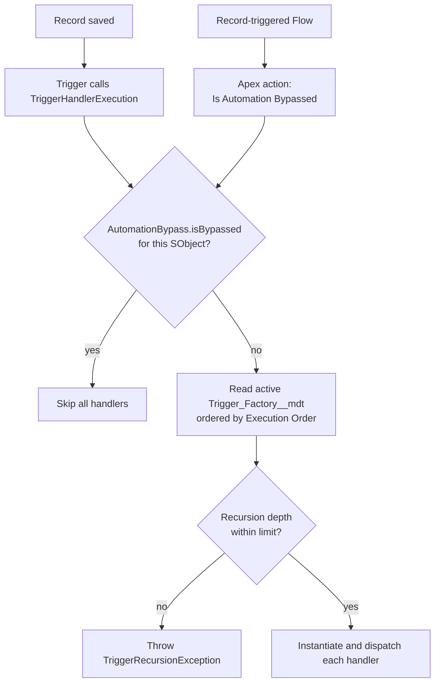

# Trigger Framework

A metadata-driven Apex trigger framework for Salesforce with a **centralised bypass mechanism shared by Apex triggers and record-triggered Flows**.

Handlers are registered as `Trigger_Factory__mdt` records rather than hardcoded in the trigger, so adding, reordering, deactivating or bypassing automation is a configuration change, not a code change.

---

## Contents

| Component | Type | Purpose |
| --- | --- | --- |
| `TriggerFactoryHandler` | Apex (abstract) | Base class every handler extends. Provides the seven trigger events and a `TriggerContext` wrapper. |
| `TriggerHandlerExecution` | Apex (singleton) | Reads the configuration, resolves handler classes dynamically, dispatches the current trigger event and enforces the recursion guard. |
| `AutomationBypass` | Apex | Single source of truth for "is automation bypassed for this object?". Used by triggers **and** exposed to Flow as an invocable action. |
| `QueryBuilder` | Apex | Fluent SOQL builder used internally. |
| `Trigger_Factory__mdt` | Custom Metadata Type | Handler registry and bypass configuration. |
| `TriggerFactoryHandlerMock` | Apex (`@IsTest`) | Test-only handler used to exercise dynamic instantiation. |

---

## How it works



`AutomationBypass` caches its decision in a **static map keyed by SObject API name**. Whichever automation runs first in the transaction evaluates the configuration once; every later caller — trigger or flow — reuses the cached value. The configuration itself is cached too, so `Trigger_Factory__mdt` is queried at most once per object per transaction.

---

## Setup

### 1. Create a handler

```apex
public with sharing class AccountValidationHandler extends TriggerFactoryHandler {
    protected override void onBeforeInsert(TriggerContext context) {
        for (Account account : (List<Account>) context.newList) {
            if (String.isBlank(account.BillingCountry)) {
                account.addError('Billing Country is required.');
            }
        }
    }

    protected override void onAfterUpdate(TriggerContext context) {
        // context.newList, context.newMap, context.oldList, context.oldMap, context.size
    }
}
```

Available overrides: `onBeforeInsert`, `onBeforeUpdate`, `onBeforeDelete`, `onAfterInsert`, `onAfterUpdate`, `onAfterDelete`, `onAfterUnDelete`. Optional hooks: `sobjectTypeSetupCallback`, `logBeforeEventHandling`, `logAfterEventHandling`.

### 2. Create the trigger

One trigger per object, containing a single line:

```apex
trigger AccountTrigger on Account (
    before insert, before update, before delete,
    after insert, after update, after delete, after undelete
) {
    TriggerHandlerExecution.getInstance().getHandler(Account.class).execute();
}
```

### 3. Register the handler

Create a `Trigger_Factory__mdt` record:

| Field | Example | Notes |
| --- | --- | --- |
| `Object_API_Name__c` | `Account` | Must match the `Type` passed to `getHandler()`. |
| `Class_Name__c` | `AccountValidationHandler` | Resolved via `Type.forName`. |
| `Execution_Order__c` | `10` | Ascending; lower runs first. |
| `Is_Active__c` | checked | Inactive rows are filtered out of the query. |
| `Bypassed_User__c` | `dataload@acme.com, migration@acme.com` | Comma-separated usernames. Optional. |
| `Bypassed_Profile__c` | `Integration User, System Administrator` | Comma-separated profile **names**. Optional. |

Matching is case-insensitive and whitespace-tolerant.

---

## Bypassing automation

### Configuration-driven (CMDT)

A handler row is skipped when the running user's **username** or **profile name** appears in its bypass fields.

The **object as a whole** is considered bypassed — and therefore Flows are skipped too — when *every* active row for that object bypasses the running user. To bypass an object that has no Apex handlers, add a single active row for it with only the bypass fields populated.

`AutomatedProcess` users (platform automation) are never bypassed.

### Record-triggered Flows

Flows cannot be intercepted from Apex, so each flow must ask:

1. Make the **first element** an **Action > Apex Action > "Is Automation Bypassed"** (category *Automation Framework*).
2. Set the **Record** input to `{!$Record}`. Leave *Object API Name* empty — the object is derived at runtime, so no flow or object name is ever hardcoded.
3. Add a **Decision** immediately after: when `isBypassed` equals `True`, connect to **End**.

> **Limitation:** before-save ("Fast Field Updates") record-triggered flows do not support Action or Subflow elements and therefore cannot call this action. Convert such a flow to after-save, or move its logic into a trigger handler where the bypass applies automatically.

### Programmatic

```apex
// Global kill switch for all Apex handlers
TriggerHandlerExecution.BYPASS = true;

// Per-object override for the rest of the transaction (data loads, migrations)
AutomationBypass.setBypass('Account', true);

// Reset
AutomationBypass.clearCache();
```

### Public API

```apex
Boolean isBypassed(String objectApiName)
Boolean isBypassed(SObjectType sobjectType)
Boolean isBypassed(SObject record)
Boolean isBypassed(Trigger_Factory__mdt config)
void    setBypass(String objectApiName, Boolean bypassed)
void    clearCache()
List<Trigger_Factory__mdt> getActiveConfig(String objectApiName)
```

Precedence: `TriggerHandlerExecution.BYPASS` > `AutomatedProcess` user type > cached decision > `Trigger_Factory__mdt` evaluation.

---

## Recursion guard

A handler that performs DML re-fires its own trigger, which re-enters the framework and runs the same handler again. To stop that becoming an infinite cascade, `TriggerHandlerExecution` tracks a re-entrancy depth per **object + trigger operation + handler class**, so one recursing handler never blocks the others.

The counter increments immediately before the handler is dispatched and decrements in a `finally` block, so an exception thrown inside a handler cannot leave a stuck counter behind.

When the limit is exceeded a `TriggerHandlerExecution.TriggerRecursionException` is thrown, naming the handler, the object and the configured maximum:

```
Maximum recursion depth of 5 exceeded for handler "ContactRollupHandler" on Account.
Check for a handler that re-triggers itself, or raise TriggerHandlerExecution.MAX_RECURSION_DEPTH.
```

```apex
// Default is 5. Raise it for a legitimate deep cascade.
TriggerHandlerExecution.MAX_RECURSION_DEPTH = 10;

// Clear the counters (tests, or a deliberately restarted cascade)
TriggerHandlerExecution.resetRecursionDepth();
```

> The exception rolls back the transaction rather than silently truncating the cascade, so a genuine recursion bug surfaces immediately instead of producing partial data.

The bounded `for` loop over the configured handlers is **not** a recursion risk — it is limited by the number of active `Trigger_Factory__mdt` rows for the object.

---

## Bulk behaviour

Both caches are transaction-scoped statics, so volume does not multiply the cost:

- `Trigger_Factory__mdt` is queried **at most once per distinct object per transaction**, shared between the trigger path and the Flow action.
- The invocable action resolves object names with `String.valueOf(SObjectType)` rather than a describe call, and evaluates each **distinct** object once before the per-request loop. A 200-record flow invocation therefore costs zero extra SOQL and zero describes.

---

## Deploy and test

```bash
sf project deploy start -d force-app -o <org-alias>
sf apex run test -o <org-alias> -l RunLocalTests -c -r human
```

Assign the `System Admin` permission set for access to the Apex classes and the custom metadata type.

Test classes: `AutomationBypassTest`, `TriggerFactoryHandlerTest`, `QueryBuilderTest`.

---

## Prerequisites

- **Salesforce CLI** — [developer.salesforce.com/tools/salesforcecli](https://developer.salesforce.com/tools/salesforcecli)
- **VS Code with the Salesforce Extension Pack** — [installation instructions](https://developer.salesforce.com/docs/platform/sfvscode-extensions/guide/install.html)
- **A Salesforce org** — [sign up for a free Developer Edition](https://developer.salesforce.com/signup)

## Project structure

- **`force-app/main/default/`** — Apex classes, the `Trigger_Factory__mdt` custom metadata type, layout, list view and permission set.
- **`config/`** — scratch org definition.
- **`scripts/`** — anonymous Apex and SOQL snippets.
- **`manifest/package.xml`** — deployment manifest.
- **`sfdx-project.json`** — package directories and API version.

## Resources

- [Salesforce CLI Command Reference](https://developer.salesforce.com/docs/atlas.en-us.sfdx_cli_reference.meta/sfdx_cli_reference/)
- [Salesforce DX Developer Guide](https://developer.salesforce.com/docs/atlas.en-us.sfdx_dev.meta/sfdx_dev/)
- [Triggers and Order of Execution](https://developer.salesforce.com/docs/atlas.en-us.apexcode.meta/apexcode/apex_triggers_order_of_execution.htm)

